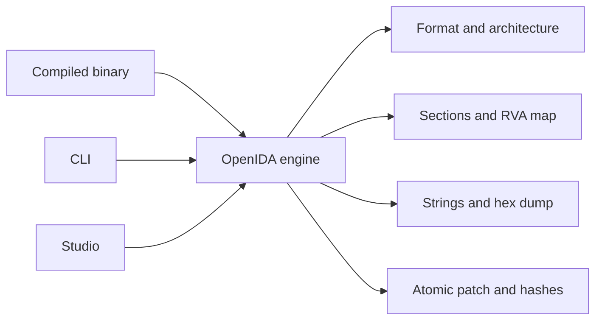

# OpenIDA


OpenIDA reads a compiled binary and tells you what is really inside it — formats, sections, strings, offsets and a verifiable patch trail — from one TypeScript-native command line and studio.

## 🔎 What it does

OpenIDA ships a small built-in analysis engine. It does not need a disassembler
service, an external SDK or a system toolchain at runtime.

| Capability | State |
| --- | --- |
| PE headers, sections, image base, entry RVA | Available |
| ELF 32/64-bit little-endian headers and sections | Available |
| Mach-O header basics (magic, CPU, file type, command count) | Detected only |
| ASCII strings extraction | Available |
| Canonical hex dump and byte reads | Available |
| RVA to file-offset mapping for PE and ELF | Available |
| Atomic byte patching with before/after hashes | Available |
| Disassembly, decompilation, debugging, symbols | Not implemented |

`open-ida capabilities` prints the same matrix as JSON, including an explicit
`unsupported` block. A suffix or a file name is never treated as a support claim.

## 🚀 Try it

```bash
open-ida capabilities
open-ida info ./samples/app.exe
open-ida strings ./samples/app.exe --min 4 --limit 100
```

`capabilities` prints the implementation matrix, including the explicit
`unsupported` block. `info` reports the detected format, architecture, entry
point, image base, section count and whole-file hash. `strings` walks printable
ASCII runs and reports their file offsets.

The remaining commands follow the same shape: `sections` lists every section with
its virtual address, raw offset, size and readable/writable/executable flags;
`hexdump` prints the canonical `offset  bytes  |ascii|` layout; `rva` maps a PE
relative virtual address or an ELF virtual address onto a file offset; `patch`
writes bytes atomically, refuses a range that does not fit the file, and reports
the before and after hash of the whole file. The source file is untouched unless
you omit the output path.

## 🧭 How it works



One engine answers every surface. The command line, the studio window and the
agent skill read the same file handles and the same reports, so a section shown
in the studio is the section the command line printed. When the studio is opened
outside a connected host it says so and stays empty instead of drawing sample
data.

## 🚧 What this build does NOT do

- **No disassembler.** There is no instruction decoder and no assembly view.
- **No decompiler.** No pseudo-code, no control-flow graph and no type recovery.
- **No debugger.** It does not attach, set breakpoints or inspect a running process.
- **No symbol or import resolution.** Import tables, export tables, relocations,
  debug directories and symbol tables are not parsed yet.
- **No Mach-O sections.** Mach-O files report header basics only; section tables
  and load commands beyond the header count are not decoded.
- **No big-endian ELF.** Big-endian files are rejected with a stable unsupported
  code instead of being guessed at.
- **No in-place overwrite by default.** Patching writes a new file unless you
  explicitly leave out the output path.
- **No release artifacts.** The project is in development and has no installers.
